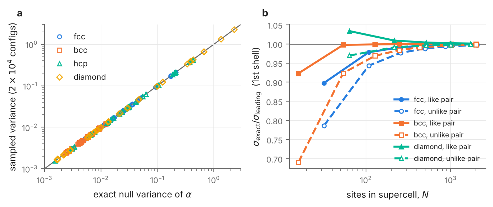
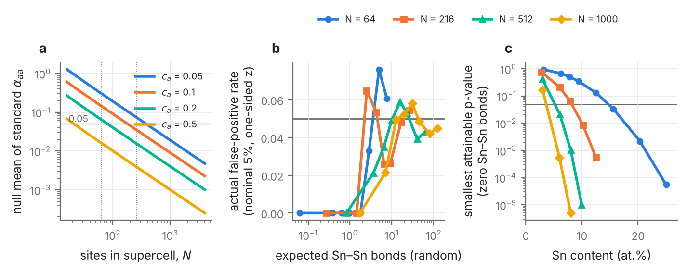
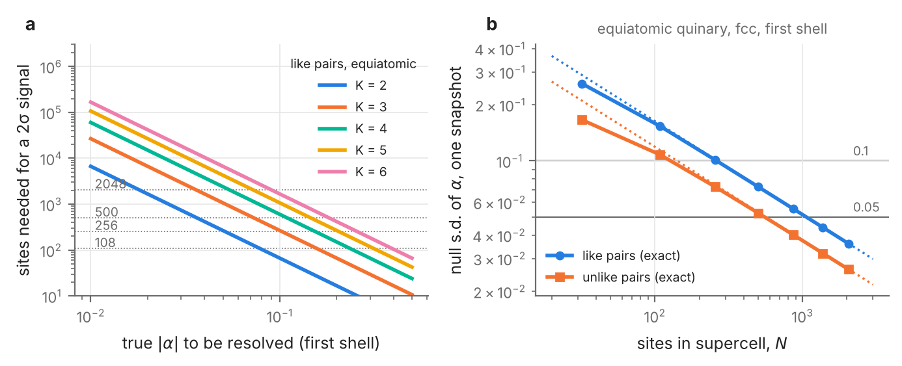
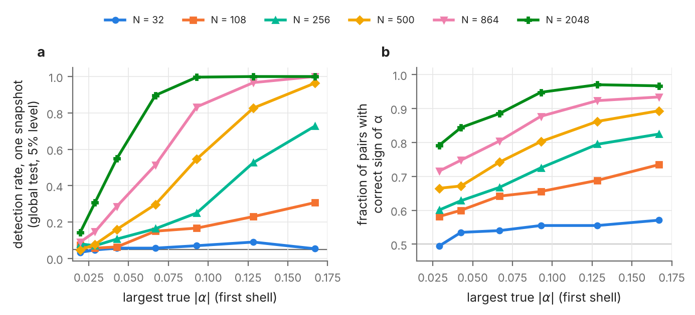
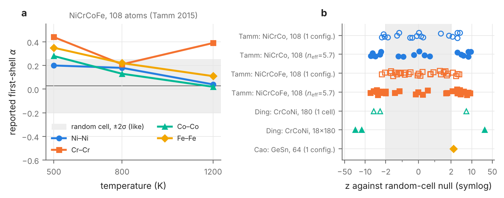
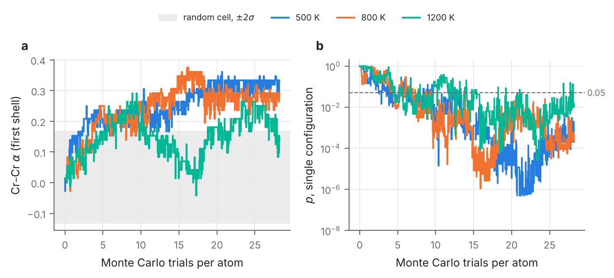

# sro-noise-floor

[](https://doi.org/10.5281/zenodo.24543374)

**Exact finite-size statistics for Warren–Cowley short-range-order parameters.**

Chemical short-range order (SRO) in alloys is usually reported as
Warren–Cowley parameters computed from Monte Carlo or DFT supercells of
100–1000 atoms. Even a perfectly random arrangement gives non-zero values
in such cells. This package gives the exact null distribution moments of
every Warren–Cowley parameter for any lattice, composition, cell size and
set of coordination shells, and uses them to test whether a computed SRO is
distinguishable from randomness.

## Main results

1. **Exact moments.** For a random arrangement at fixed composition, the
   mean and full covariance (all species pairs, all shells) of the pair
   counts depend on the lattice through only three graph invariants
   (bond count, degree products, shared bond multiplicities). They are
   evaluated in exact rational arithmetic and agree with full enumeration
   of all arrangements to 10⁻¹⁰ ([docs/theory.md](docs/theory.md)).

2. **The textbook estimator is biased in small cells.**
   With α = 1 − P(b|a)/c_b, a random cell has
   E[α_ab] = −1/(N−1) for unlike pairs and
   E[α_aa] = (1−c_a)/(c_a(N−1)) for like pairs, for every lattice and shell.
   For 4 Sn atoms in a 64-atom diamond cell the random value of α_SnSn is
   **+0.238**, i.e. apparent Sn–Sn avoidance with no interaction at all.
   Using (n_b − δ_ab)/(N − 1) as the reference probability removes the bias
   exactly.

3. **The noise floor depends only on the number of bonds.**
   To leading order, with B = Nz/2 bonds in the shell,

   - Var(α_aa) = (1 − c_a)² / (B c_a²)
   - Var(α_ab) = [(1 − c_a)(1 − c_b) + c_a c_b] / (2 B c_a c_b)

   For an equiatomic quinary fcc alloy in a 108-atom cell, the first-shell
   null standard deviation is 0.17 for like pairs and 0.11 for unlike pairs.
   Resolving |α| = 0.05 at 2σ needs about 4300 atoms.

4. **Single small-cell snapshots rarely detect real SRO.** In a quinary fcc
   lattice gas whose true first-shell order reaches |α| = 0.17, a
   108-atom snapshot is flagged as non-random only 31 % of the time and
   gets the sign of α right for 73 % of pairs. A 2048-atom snapshot is
   flagged every time (Fig. 4).

5. **Dilute solutes need exact tests.** For GeSn, the Sn–Sn bond count in
   a small cell is a handful of integers. A 64-atom cell with ≤ 9 Sn atoms
   (≤ 14 %) cannot demonstrate Sn–Sn avoidance from one configuration
   even if it contains no Sn–Sn bonds at all: the probability of zero
   bonds in a random cell is 0.13 for 8 and 0.07 for 9 Sn atoms (Fig. 2c).

6. **Published small-cell results, reassessed** (Figs. 5 and 6,
   `scripts/reassess_literature.py`, `scripts/tamm_chains.py`). For NiCrCo
   and NiCrCoFe in 108-atom cells (Tamm et al., Acta Mater. 2015; 400 and
   600 MC steps, about 4–6 swap trials per atom), the DFT-MC trajectories
   the authors later released (doi:10.23673/RE-518; mostly preliminary
   runs) show that an average over the second half of a run, 50 to 1500
   snapshots, carries the information of only 4–11 independent
   configurations (median 5.7); the scatter between runs with different
   seeds agrees with this to within a factor 1.4 in variance. With this
   n_eff all six tabulated states are non-random (global p ≤ 2×10⁻⁴), but
   the tabulated values scatter with temperature about twice as much as
   sampling alone allows, and in the longest released runs the parameters
   at 4–6 trials per atom differ from the late-run values by 0.06–0.11
   (rms), so the reported budget does not reach equilibrium in those runs.
   The CrCoNi values of Ding et al. (PNAS 2018; 18 independent 180-atom
   cells) are significant even for a single cell (|z| = 3–6.5). For GeSn
   (Cao et al., ACS AMI 2020; 32-, 64- and 128-atom cells) the Sn–Sn
   avoidance is real, but the random reference coordination number is
   0.90, 0.95 and 0.98 in those cells, not 1; in a 64-atom cell the offset
   grows to 11 % at 12.5 % Sn.

7. **Averaging correlated snapshots** (`scripts/snapshot_averaging.py`).
   Averaging 10–50 snapshots taken a few exchanges apart in a chain that
   samples the random state, and dividing the null covariance by the
   number of snapshots, declares a random 108-atom cell ordered in up to
   99 % of cases; dividing by n_eff restores the nominal rate.

## Install

```bash
pip install .            # numpy, scipy; matplotlib for the scripts
python -m pytest         # 23 tests, ~25 s
```

The Monte Carlo kernel used in Fig. 4 is plain C and is compiled with the
system compiler on first use.

## Usage

### Test a structure file

```bash
python -m sronoise POSCAR --shells 2            # add --perm 20000 for exact p-values
```

Two 108-atom CrMnFeCoNi cells are provided in `examples/`
(`python examples/make_example.py` regenerates them). The first is a
purely random arrangement:

```
$ python -m sronoise examples/POSCAR_random --shells 2
108 sites; shells at 2.546, 3.600 ; z = 12, 6
shell 1  Cr-Cr  alpha=+0.0350  null=+0.0000+-0.1500  z=+0.23  p=0.816
shell 1  Cr-Mn  alpha=+0.2262  null=+0.0000+-0.1057  z=+2.14  p=0.0323
shell 1  Cr-Fe  alpha=+0.0236  null=+0.0000+-0.1057  z=+0.22  p=0.823
...
global chi2=19.87  dof=20  p=0.466
```

A Cr–Mn value of +0.23, larger than many reported SRO parameters, appears
in a random cell, and on its own it even passes p < 0.05. With 30
parameters tested, that is expected; the global test, which accounts for
all of them and their correlations, correctly finds nothing (p = 0.47).
The second cell was equilibrated by swap Monte Carlo with Cr–Cr repulsion
and Cr–Ni attraction:

```
$ python -m sronoise examples/POSCAR_ordered --shells 2
shell 1  Cr-Cr  alpha=+0.5368  null=+0.0000+-0.1500  z=+3.58  p=0.000346
shell 1  Cr-Ni  alpha=-0.4282  null=+0.0000+-0.1086  z=-3.94  p=8.09e-05
...
global chi2=54.78  dof=20  p=4.43e-05
```

Use ideal (unrelaxed) lattice positions, or set `--tol` larger than the
relaxation displacements. `--species` restricts the analysis to one
sublattice (e.g. the cation sublattice of an oxide).

### Python

```python
import numpy as np
from sronoise import build_supercell, WCNull, random_configs, significance_test

cell = build_supercell("fcc", 3, n_shells=2)          # 108 sites
counts = [22, 22, 22, 21, 21]
null = WCNull(cell, counts)
print(null.mean("standard"))                          # exact bias
print(np.sqrt(np.diag(null.cov("unbiased"))))         # exact noise floor

config = random_configs(counts, 1, rng=0)[0]          # or your own (N,) labels
res = significance_test(cell, config, null=null)
print(res.table(["Cr", "Mn", "Fe", "Co", "Ni"]))
```

For an average over `n` Monte Carlo snapshots, pass the (n, N) array of
configurations; the null covariance is then divided by n, which is only
correct for uncorrelated snapshots (see docs/theory.md §6).

## Reference noise floor (first shell, unbiased estimator, one snapshot)

σ is the exact null standard deviation; "like" is the minority (last)
species. The bias column is the null mean of the standard estimator.

| system | N | σ(α) like | σ(α) unlike | standard-estimator bias (like) |
|---|---:|---:|---:|---:|
| CrMnFeCoNi (fcc, equiatomic) | 108 | 0.169 | 0.112 | +0.041 |
| CrMnFeCoNi (fcc, equiatomic) | 256 | 0.099 | 0.072 | +0.015 |
| CrMnFeCoNi (fcc, equiatomic) | 500 | 0.073 | 0.053 | +0.008 |
| CrMnFeCoNi (fcc, equiatomic) | 864 | 0.056 | 0.040 | +0.005 |
| CrMnFeCoNi (fcc, equiatomic) | 2048 | 0.036 | 0.026 | +0.002 |
| CrCoNi (fcc, equiatomic) | 108 | 0.076 | 0.059 | +0.019 |
| CrCoNi (fcc, equiatomic) | 256 | 0.050 | 0.039 | +0.008 |
| CrCoNi (fcc, equiatomic) | 500 | 0.036 | 0.029 | +0.004 |
| CrCoNi (fcc, equiatomic) | 864 | 0.028 | 0.022 | +0.002 |
| CrCoNi (fcc, equiatomic) | 2048 | 0.018 | 0.014 | +0.001 |
| NbMoTaW (bcc, equiatomic) | 128 | 0.132 | 0.096 | +0.024 |
| NbMoTaW (bcc, equiatomic) | 250 | 0.092 | 0.069 | +0.012 |
| NbMoTaW (bcc, equiatomic) | 432 | 0.072 | 0.053 | +0.007 |
| NbMoTaW (bcc, equiatomic) | 1024 | 0.047 | 0.035 | +0.003 |
| NbMoTaW (bcc, equiatomic) | 2000 | 0.034 | 0.025 | +0.002 |
| Ge0.9375Sn0.0625 (diamond) | 64 | 1.517 | 0.076 | +0.238 |
| Ge0.9375Sn0.0625 (diamond) | 216 | 0.719 | 0.046 | +0.067 |
| Ge0.9375Sn0.0625 (diamond) | 512 | 0.476 | 0.031 | +0.029 |
| Ge0.9375Sn0.0625 (diamond) | 1000 | 0.341 | 0.022 | +0.015 |
| Ge0.875Sn0.125 (diamond) | 64 | 0.655 | 0.082 | +0.111 |
| Ge0.875Sn0.125 (diamond) | 216 | 0.342 | 0.047 | +0.033 |
| Ge0.875Sn0.125 (diamond) | 512 | 0.220 | 0.031 | +0.014 |
| Ge0.875Sn0.125 (diamond) | 1000 | 0.157 | 0.022 | +0.007 |

Full table: [data/reference_table.csv](data/reference_table.csv).

## Figures

| | |
|---|---|
|  | **Fig. 1** (a) Exact null variances against 2×10⁴ random arrangements for 354 parameters (fcc, bcc, hcp, diamond; 2–5 species; 1st–3rd shells). The relative deviation has s.d. 0.93 %, the sampling error expected for 2×10⁴ samples. (b) Exact/leading-order standard deviation, first shell, equiatomic quinary. |
|  | **Fig. 2** (a) Null mean of the standard like-pair estimator. (b) Actual false-positive rate of a nominal 5 % one-sided z-test for Sn–Sn avoidance in diamond-lattice GeSn. (c) Smallest attainable p-value for avoidance from a single configuration. |
|  | **Fig. 3** (a) Sites needed for a 2σ first-shell signal, fcc, equiatomic K-component alloys. (b) Exact noise floor for an equiatomic quinary fcc cell; dotted: leading order. |
|  | **Fig. 4** Swap Monte Carlo of a quinary fcc lattice gas with fixed first-shell pair interactions, 300 independent snapshots per point. (a) Detection rate of the global χ² test. The false-positive rate on random cells is 4–7 % for all sizes. (b) Fraction of pairs with true \|α\| > 0.02 whose sign is reproduced by one snapshot. |
|  | **Fig. 5** (a) First-shell like-pair values reported for NiCrCoFe in a 108-atom cell (Tamm et al. 2015) with the ±2σ band of a random 108-atom cell. (b) z-scores of published values against the exact random-cell null; for Tamm et al. both for one configuration (open) and for the n_eff measured on their trajectories (filled). |
|  | **Fig. 6** DFT-MC trajectories of NiCrCo (108 atoms) released by Tamm et al.: (a) Cr–Cr parameter along the chain with the ±2σ band of a random cell; (b) p-value of the global test for each configuration. |

## Reproduce

```bash
cd scripts && ./run_all.sh     # about 7 minutes on 2 cores
```

Raw numbers behind every figure are written to `data/`.

## Repository layout

```
src/sronoise/   lattice.py   supercells, shells, POSCAR input
                moments.py   exact rational moments
                counting.py  pair counts and estimators
                stats.py     z, global chi2, permutation tests, closed forms
                mc.py        swap Monte Carlo (C kernel _kawasaki.c)
scripts/        figure and table scripts
docs/theory.md  derivations
tests/          pytest suite (enumeration, sampling, asymptotics, CLI)
```

## Relation to previous work

* **Join-count statistics.** Pair counts on a lattice are the "join counts"
  of spatial statistics. Their mean and variance for k colours under
  sampling without replacement are classical (Dacey 1968; Cliff and Ord,
  *Spatial Processes*, 1981) and are implemented, for example, in the R
  package `spdep`. This work builds on that result and adds: the full
  covariance between all species pairs *and* between different shells;
  periodic cells in which a pair of sites is joined by several lattice
  vectors; the mapping to Warren–Cowley parameters, including their
  composition-independent finite-cell bias and an exactly unbiased
  estimator; a leading-order law in terms of the bond count; and a
  global test that accounts for the constraints and correlations.
* **Empirical randomness checks.** Several codes judge the randomness of
  a supercell by comparing its Warren–Cowley parameters with those of
  randomly generated cells (e.g. the randomness score of SimplySQS,
  arXiv:2510.18020). The exact moments here give the same reference
  without sampling and extend it to formal tests.
* **Observations of the effect.** Small-cell studies have noted that
  random cells yield a spread of α and values biased away from zero
  (e.g. arXiv:2307.05709). The present results quantify both exactly.

## Scope and limitations

* The null model is a random arrangement on a fixed lattice. It says
  nothing about lattice relaxations, which do not enter the WC parameters.
* Single-sublattice crystals are handled directly; for multi-sublattice
  compounds apply the analysis to one sublattice (`--species`).
* Snapshots from one Monte Carlo chain are correlated; use an effective
  sample size.

## Citation

If you use this code, please cite the archived release:

```
Y. Shan, sro-noise-floor: exact finite-size statistics for Warren-Cowley
short-range-order parameters, version 0.2.0 (2026).
Zenodo. https://doi.org/10.5281/zenodo.24543374
```

```bibtex
@software{shan_sro_noise_floor_2026,
  author    = {Shan, Yingjie},
  title     = {sro-noise-floor: exact finite-size statistics for
               Warren-Cowley short-range-order parameters},
  version   = {0.2.0},
  year      = {2026},
  publisher = {Zenodo},
  doi       = {10.5281/zenodo.24543374},
  url       = {https://doi.org/10.5281/zenodo.24543374}
}
```

## License

MIT
